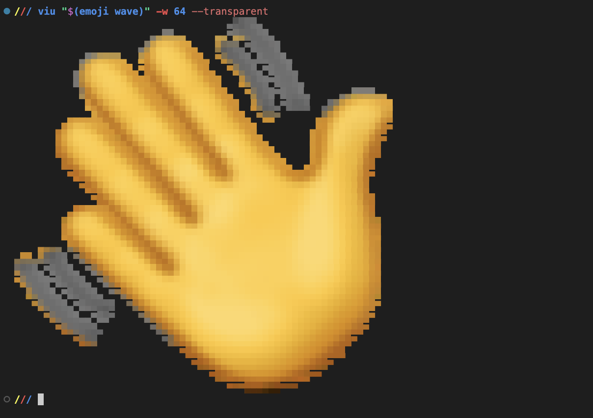
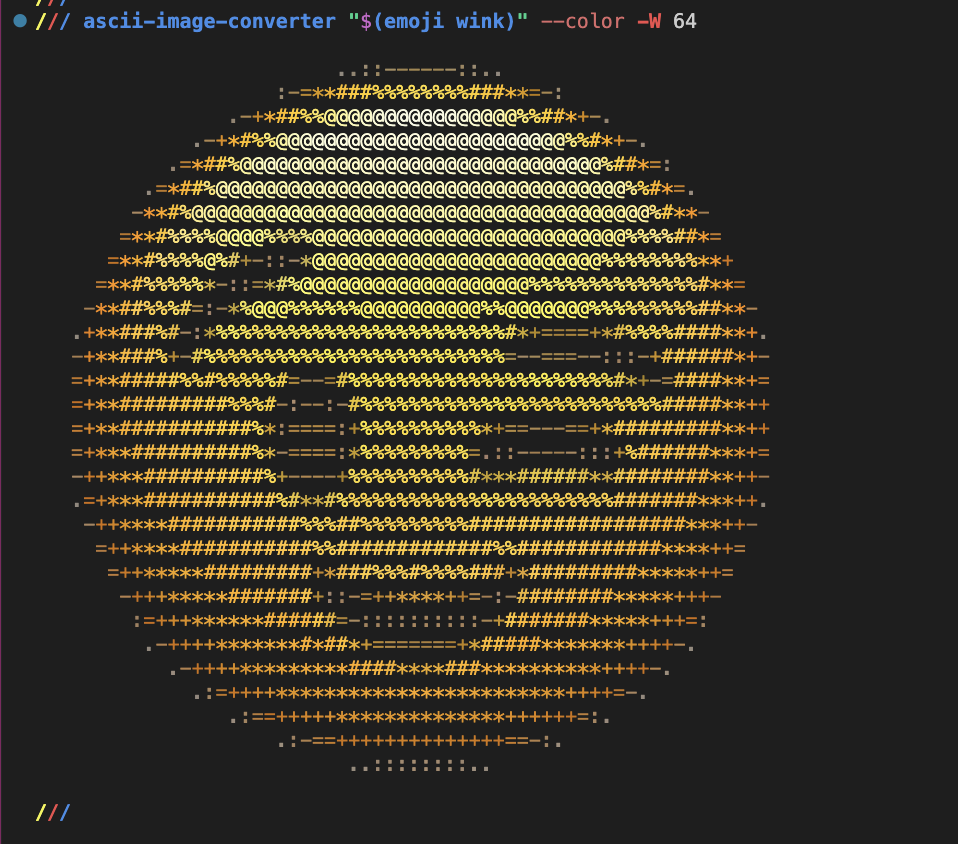

# Emoji Toolkit

[](https://pypi.org/project/emoji-toolkit/)
[](https://github.com/AdrieanKhisbe/emoji-toolkit/actions/workflows/tests.yml)
[](https://github.com/AdrieanKhisbe/emoji-toolkit/issues)
[](LICENSE)

> Get emoji images or data URLs from your terminal for notifications, scripts, and everyday tools. :fishing_pole_and_fish:

Pick a vendor, look up a shortcode, and use the artwork anywhere.

## Install :cd:

Requires Python 3.11+.

```sh
uv tool install emoji-toolkit

emoji setup
```

Alternative install methods:
```sh
# Or use pipx:
pipx install emoji-toolkit
# Or use pip
pip install emoji-toolkit
```

On macOS, Linux, and Windows, `emoji setup` installs the OS vendor as your default after
confirmation. If the OS vendor is already installed, setup leaves your
installation and preferences unchanged.
Use `emoji setup --yes` in scripts; `emoji install` lets you pick vendors yourself.
Installation downloads artwork to `~/.local/share/emojies/`
(or `$XDG_DATA_HOME/emojies/` when set). Those are then used offline.

## Use it :rugby_football:

```sh
emoji smiley                         # original PNG path
# /Users/ak/.local/share/emojies/vendors/apple/grinning_face_with_big_eyes.png
emoji smiley --url                   # PNG preview data URL
# data:image/png;base64,iVBOR.....RK5CYII=
emoji smiley --url --size 128         # generate a preview within 128×128

emoji wave --skin-tone dark          # choose a skin tone 👋🏿
emoji smiley --vendor google         # choose a specific vendor

emoji list hand                      # discover shortcodes with hands
emoji list hand --emoji              # show Unicode emoji alongside shortcodes "✋ hand"
emoji list hand --colon              # wrap shortcodes in colons :hand:
```

Skin tones for `--skin-tone` and `config set skin-tone`: `light` 👋🏻,
`medium-light` 👋🏼, `medium` 👋🏽, `medium-dark` 👋🏾, `dark` 👋🏿,
and `none` 👋 for the unmodified emoji.

Use the returned path with an image viewer or notification tool you have installed:

```sh
viu "$(emoji wave)" --transparent                       # view in your terminal
ascii-image-converter "$(emoji wink)" --color           # render as ASCII art
notify-send --icon="$(emoji tada)" "Build finished"     # Linux desktop notification
```

See [viu](https://github.com/atanunq/viu),
[ascii-image-converter](https://github.com/TheZoraiz/ascii-image-converter), and
[notify-send](https://manpages.ubuntu.com/manpages/resolute/man1/notify-send.1.html).

| Terminal viewer · `viu` | Colored ASCII · `ascii-image-converter` |
| :---: | :---: |
|  |  |

| Desktop notification |
| :---: |
|  |

Shortcodes follow GitHub aliases. Colons are optional: `smiley` and
`:smiley:` work the same way. 😃
Paths point to original images; data URLs default to previews up to 72×72 pixels.
Use `--size 1–1024` with `--url` to choose a preview size; original artwork is never enlarged.

## Manage your artwork :art:

Your first installed vendor becomes the default. Change your preferences,
refresh installed artwork, or remove vendors you no longer use:

```sh
emoji config set vendor apple
emoji install --vendor google --use-as-default  # install and choose the default
emoji config set skin-tone dark
emoji config unset skin-tone

emoji install --update --vendor apple  # refresh Apple artwork
emoji install --update                 # refresh all installed artwork
emoji status                           # show installed vendors and versions
emoji uninstall --vendor twitter       # remove artwork you no longer need
```

See [all commands and options](docs/cli.md).

## Pick your artwork :rainbow:

Choose artwork from seven vendors:
- `apple`: [Apple](https://emojipedia.org/apple)
- `emojione`: [JoyPixels](https://emojipedia.org/joypixels)
- `facebook`: [Facebook](https://emojipedia.org/facebook)
- `google`: [Google Noto Color Emoji](https://emojipedia.org/noto-color-emoji)
- `samsung`: [Samsung](https://emojipedia.org/samsung)
- `twitter`: [Twitter / X](https://emojipedia.org/twitter)
- `windows`: [Microsoft Windows](https://emojipedia.org/microsoft)

```sh
emoji install --vendor google --vendor twitter
emoji install --all
```

The same 😃 `:smiley:`, drawn by each vendor:

| Vendor | Apple | JoyPixels | Facebook | Google | Samsung | Twitter / X | Microsoft Windows |
| --- | :---: | :---: | :---: | :---: | :---: | :---: | :---: |
| Smiley |  |  |  |  |  |  |  |

## Explore the dataset :world_map:

The checked-in artwork lives in [`resources/dataset`](resources/dataset):

- `dataset.json` — the shared Unicode index.
- `vendors/<vendor>.json` — image paths, preview data URLs, and source metadata.
- `images/<vendor>/` — original artwork.

Join vendor records to the index by their `unicode` sequence. Reading the JSON
and images requires no Python dependencies.

See [dataset maintenance](docs/dataset-maintenance.md) and
[publishing resource bundles](docs/resource-releases.md).

## Contribute :handshake:

From a checkout, use Python 3.11+ and Poetry 2+:

```sh
poetry install
poetry run poe local-install            # install Apple artwork from this checkout
poetry run poe format
poetry run poe format-check
poetry run poe typecheck
poetry run poe test
```

Have a bug or an idea? [Open an issue](https://github.com/AdrieanKhisbe/emoji-toolkit/issues).
For artwork problems, include the emoji and vendor.

## License

Project code is licensed under [MIT](LICENSE). Vendor artwork retains its
respective copyrights and licenses; see [Emojipedia's licensing guide](https://emojipedia.org/licensing).
